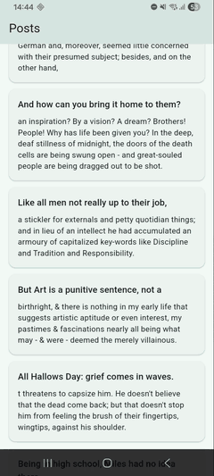

# Flutter Infinite ListView

A minimal example of infinite scrolling in Flutter. Posts load page by page from
[DummyJSON](https://dummyjson.com/docs/posts) as you scroll.

[Live demo](https://sharmadhiraj.github.io/flutter_infinite_listview/)



## Features

- Loads the next page before you reach the end of the list
- Loading indicator, and a retry button when a request fails
- Pull to refresh
- Runs on Android, iOS and web

## Project structure

```
lib/
  main.dart                    App entry point and theme
  models/                      Post and PostPage
  services/post_service.dart   Paginated API request (limit and skip)
  screens/post_list_screen.dart  Scrolling, paging and state
  widgets/                     PostCard and RetryButton
```

## Run

```sh
flutter run
```

## Need this in your app?

Use the [infinite_listview_package](https://pub.dev/packages/infinite_listview_package)
package instead of writing the paging logic yourself.
